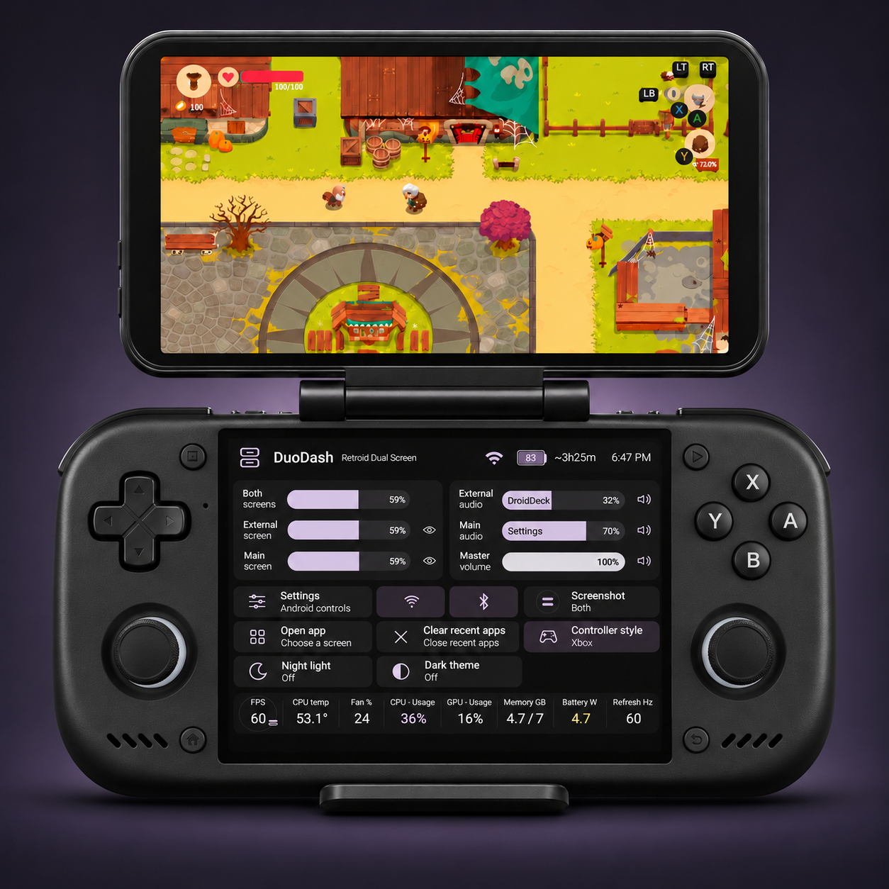
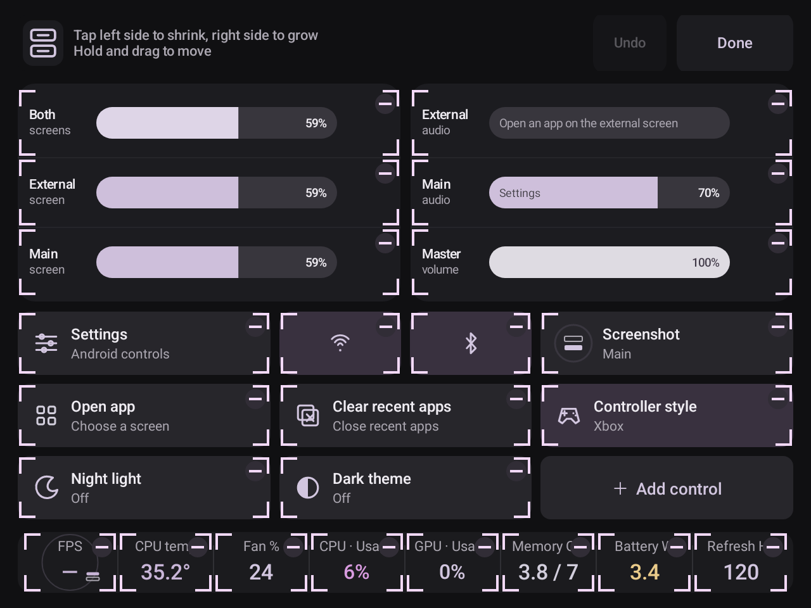

# DuoDash

The Retroid Dual Screen Add-on is great, but a few missing software touches make it less convenient than it could be. DuoDash grew out of wanting separate brightness and audio controls for both screens, all a button press away. The AYN Thor control center was the inspiration: quick changes without constantly pulling down Android's notification shade while playing.

Then there's switching between the add-on, a TV and AR glasses, each needing different settings. DuoDash remembers those for you. And even without a second screen, it's handy for quick controls on the handheld.

Thanks to the awesome people who helped test it and shape how it works.

**[Releases](https://github.com/gevky/DuoDash/releases)** · **[Add to Obtainium](https://apps.obtainium.imranr.dev/redirect?r=obtainium://app/%7B%22id%22%3A%22dev.nova.deck%22%2C%22url%22%3A%22https%3A%2F%2Fgithub.com%2Fgevky%2FDuoDash%22%2C%22author%22%3A%22gevky%22%2C%22name%22%3A%22DuoDash%22%2C%22overrideSource%22%3A%22GitHub%22%2C%22additionalSettings%22%3A%22%7B%5C%22includePrereleases%5C%22%3Atrue%7D%22%7D)** · Android 13+

Tested on Retroid Pocket Nova. Other devices and hardware controls depend on firmware.

## Setup

The three-step wizard guides you through:

1. Allowing overlay and Accessibility access.
2. Pairing system controls through Wireless debugging.
3. Saving a controller shortcut, then finishing setup.

Connect to Wi-Fi for pairing. Keep Android's pairing-code window open while entering the code in DuoDash. After pairing, DuoDash enables USB debugging so controls keep working with Wi-Fi off. Setup checks that it is on and offers Developer options if Android blocks the change.

Keep **USB debugging on**. No USB cable or computer is needed during use. Wi-Fi and Wireless debugging can be turned off afterward. After a restart, briefly enable them if needed and use **Settings → Connection → Restore controls**. Your pairing and layout stay saved.

## Using DuoDash

Without an external display, DuoDash shows only main brightness and master volume. The four dual-screen bars return when you reconnect, unless you removed them in Edit mode.

Your shortcut opens and closes the dashboard. **Tap the DuoDash logo** for **Close**, **Edit** and **Settings**. The dashboard's Settings control button opens Android settings.

**Quick settings** is an optional control you can add in Edit mode. It opens Android's quick-settings panel.

In **Edit**, hold and drag to move controls. Tap a control button's left side to shrink it or right side to grow it. Use the minus to remove it, **Add control** or **Add an app** to add one, and **Done** to finish. **Undo** takes you back a step. Tap CPU or GPU to switch between usage and clock speed.

*Make it yours: move, resize, add or remove controls.*

## Settings

- **Dashboard:** slider direction, floating button and status indicators. **Touch only** disables controller navigation; otherwise use D-pad, A and B.
- **Display:** profile name, resolution, aspect ratio and where DuoDash opens. Choose **Use external screen** for one Android session on your TV or glasses, or **Use both screens** for separate apps.
- **Shortcuts:** record the DuoDash shortcut and button combinations for controls. Tap an assigned combination to change it or remove it with ×. If a shortcut is part of a longer combination, it runs on release; the longer combination takes priority.
- **Connection:** restore system controls, manage permissions and hide the background notification.

Each display remembers its brightness, audio and handheld screen-off setting too. The control layout stays shared. In external-screen mode, the handheld follows the selected aspect ratio and may show black borders.

## Screenshots

Tap **Screenshot** to choose Main, External or Both. Hold for **1 second** to capture. The stacked screen icons show your selection.

Images save to **Pictures/DuoDash**. Both saves two separate images. To include the dashboard, enable **Include DuoDash** in **Settings → Dashboard**.

## Known issues

- Swapping or moving running emulators between screens can restart or crash them. Changing resolution can also restart an app.
- After closing DuoDash, controller focus may not return correctly to an external app. Use **Touch only** if controller navigation interferes with your game.
- Recovery after a reboot and restoring display settings after unplugging and reconnecting still need further testing.
- External brightness uses software dimming. FPS is an estimate of displayed frames.

[Report a problem](https://github.com/gevky/DuoDash/issues) · [Third-party licenses](app/src/main/assets/ThirdPartyNotices.txt)
